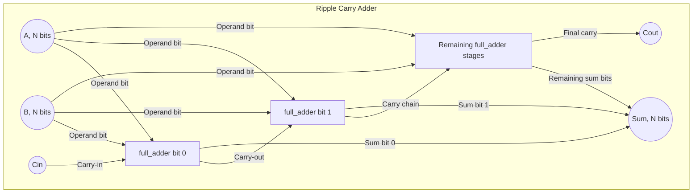
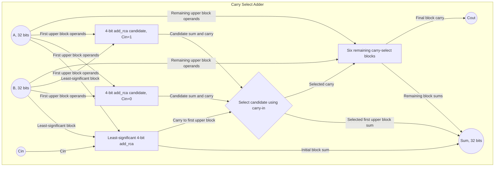
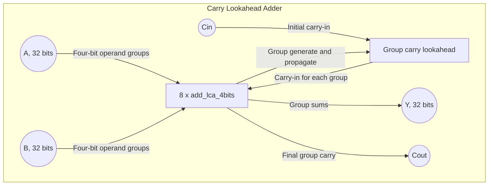
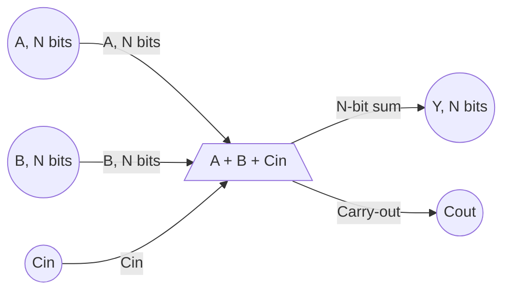

# Arithmetic Unit

This project implements arithmetic algorithms and compares their hardware
characteristics. The work completed so far focuses on four ways to add two
32-bit operands with a carry-in: a Ripple Carry Adder (RCA), a Carry Select
Adder (CSA), a Carry Lookahead Adder (CLA), and the generic Verilog `+`
operator. Each implementation is combinational and produces a 32-bit sum and
a carry-out.

## Addition architectures

### Ripple Carry Adder (RCA)

[`add_rca.v`](./add_rca.v) connects one-bit `full_adder` stages in series.
Each stage computes one sum bit and passes its carry to the next stage. This
simple structure has a carry path that can traverse all bits, so its delay
increases with operand width. The implementation is parameterized by `N`.

### Carry Select Adder (CSA)

[`add_csa.v`](./add_csa.v) divides the 32-bit operands into four-bit blocks.
The least-significant block uses the actual carry-in. For each remaining
block, two `add_rca` instances calculate candidate sums and carries assuming
the incoming carry is zero or one. A mux selects the candidate matching the
carry from the preceding block. This reduces carry-dependency delay at the
cost of duplicated block adders and selection logic. `N` must be a multiple
of four.

### Carry Lookahead Adder (CLA)

[`add_lca.v`](./add_lca.v) uses eight four-bit [`add_lca_4bits.v`](./utils/add_lca_4bits.v)
blocks. Each block computes its sum and group generate/propagate signals.
Lookahead equations use those signals to determine the carries between
blocks, reducing dependence on a bit-by-bit carry chain. The top-level
implementation is fixed to 32 bits and the group module to four bits.

### Generic Verilog addition operator

[`add_plus.v`](./add_plus.v) describes the operation `{Cout, Y} = A + B + Cin`
using Verilog's built-in arithmetic operator. The RTL leaves the adder
structure to synthesis, making this a useful baseline for comparing
hand-described architectures. The width is parameterized by `N`.

This implementation is combinational and has no clock domain, registers, or
control path.

## Synthesis comparison

The following results were obtained by synthesizing the four implementations
with Yosys using a logic-cell set of AND, OR, and XOR gates. The Carry Select
implementation also uses NOT gates, as reflected in its reported breakdown.

| Architecture | Total cells (area) | Logic breakdown | Latency (LTP) |
| --- | ---: | --- | ---: |
| Ripple Carry Adder (RCA) | 224 | 64 AND, 64 OR, 64 XOR | 66 |
| Generic operator (`+`) | 183 | 65 AND, 54 OR, 64 XOR | 57 |
| Carry Lookahead Adder (CLA) | 212 | 83 AND, 57 OR, 64 XOR | 46 |
| Carry Select Adder (CSA) | 403 | 129 AND, 116 OR, 58 XOR, 25 NOT | 37 |

In these results, the Carry Select Adder has the lowest LTP and the highest
cell area. The generic operator has the lowest total cell area. These figures
are specific to the synthesis setup used for this comparison.

## Simulation

[`testbench/adder_tb.v`](./testbench/adder_tb.v) applies common input vectors
to the four implementations and displays their outputs for comparison.

## Planned work

Future work will add and compare multiplication, division, and floating-point
algorithms.
